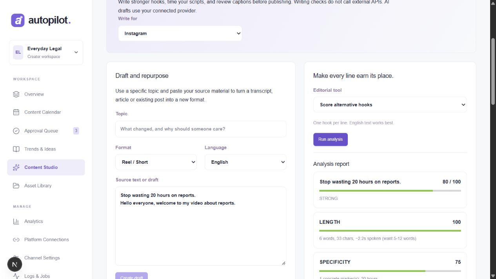

# Integration and reliability audit — October 11, 2026

## Integrated sources

- [Instagram agent skills](https://github.com/Jakeschincariol/instagram-agent-skill): 26 hook formulas, hook scoring, beat timing, caption linting, outlier analysis, carousel/repurposing guidance.
- [YouTube agent skills](https://github.com/Jakeschincariol/youtube-agent-skill): 21 hook formulas, title/thumbnail linting, outliers, retention CSV analysis, chapters, transcript edit suggestions and Shorts guidance.
- [LinkedIn agent skills](https://github.com/Jakeschincariol/linkedin-agent-skill): 21 hook formulas and local writing cleanup/style analysis; copy-ready text and slide export. LinkedIn auto-publishing is not implemented.

Source revisions are pinned in vendor/sources.json. Original MIT licenses are retained. Twenty-two relevant skills are also installed in the owner's Codex skills directory and are available to Codex on the next turn. Website integration works independently of that installation.

## Behavior fixed

- Eleven allowlisted executable editorial tools, with bounded subprocesses, no shell interpolation, UTF-8 input/output, scratch-file cleanup, and useful format instructions. Lint warnings are treated as reports instead of failed executions.
- Actual browser payloads with a null unsaved draft now work in the studio.
- Non-English scripts retain their joiners; English-only heuristics do not receive misleading translated scores.
- Optional AI failure produces a clearly identified editable template. Template content never silently becomes eligible for real publishing.
- Bundled FFmpeg produces playable MP4 previews; media endpoints support authenticated byte ranges and reject invalid ranges/traversal. The browser decoded a newly generated 30-second video without a media error. Speech synthesis also produced a separate test MP3.
- Generate processes immediate jobs; a background worker handles unattended scheduled jobs and exposes a heartbeat.
- General trend discovery is independent of AI mode and niche ranking; source status, region, approximate signal scores and source URLs remain visible. Niche discovery remains optional.
- A weekly plan avoids occupied slots and cannot schedule unapproved drafts.
- OAuth starts on a consistent hostname; Facebook scopes omit Instagram-only permissions. Callback state cookies clear at the correct path. Multiple Meta accounts can be selected using temporary encrypted server-side state; access tokens are not sent to the browser. YouTube reconnect retains an existing refresh token.
- Credentials can be entered through Platform Connections, encrypted at rest and omitted from responses. Same-origin checks account for Next's localhost/127.0.0.1 normalization.
- Approval targets only selected connected compatible accounts, so one account can complete a publication. Missing setup pauses jobs without consuming attempts; ambiguous remote outcomes remain protected against duplicate retries. Public HTTPS media hosting is checked before live Meta scheduling.
- Captions, title/description lengths, media licensing and factual risk remain checked. Editing now includes on-screen slides, hashtags and target duration. Page recovery and retry affordances preserve saved data.

## Validation

All 46 regression tests pass across 16 files. The expanded regression suite covers actual local editorial scripts, generated MP4 structure, configuration encryption/redaction, local security-key provisioning and preservation, same-origin protection, OAuth callbacks/account selection, API generation/editing, scheduling, format compatibility, queue recovery, media ranges and duplicate-publication protection. TypeScript and production builds pass. The in-app browser opened every dashboard page, executed real hook scoring, generated a Reel and confirmed readyState 4, duration 30 seconds and no media error.

## Remaining external setup

No real social credentials or live accounts were supplied, so live Google/Meta login and posting cannot be claimed as verified. Add developer-app credentials and optional AI provider keys in Platform Connections, register the exact callback shown, and grant the required account permissions. Instagram/Facebook also require exported files at a public HTTPS media base URL. A configured URL does not create hosting or upload files. Unattended local work requires the app and worker to remain running; deployment needs durable storage and owner authentication.

Scores are text heuristics, not promises of reach, factual verification or AI detector results. Manual review is the default. Service outages and permission failures are shown as actionable states, never as fake successful posts.
