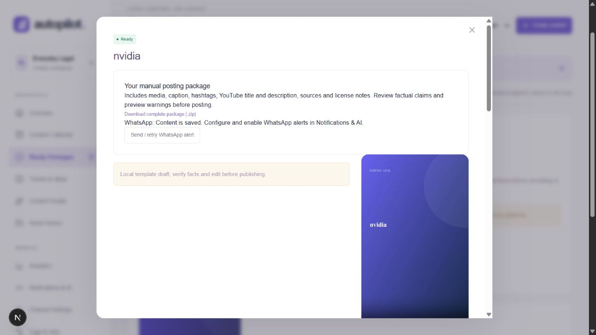

# Manual posting and WhatsApp alerts

The default workflow is discover → create → check → package → notify. Automatic publishing is disabled in this workspace. Ready Packages replaces the approval queue, and Notifications & AI replaces social-account setup. No Instagram, Facebook or YouTube account connection is needed to download and post manually.

Automatic generation is enabled, respecting each channel's pause setting and daily cap (up to two). The worker researches trends daily, prioritizes feed signals, generates scripts/media, runs quality checks, then queues a WhatsApp notification for each completed revision. Failed quality checks remain in review and do not trigger a ready alert. Reel alerts require an MP4. Preview/template packages are clearly identified and still need editing and factual review.

A ZIP includes posting-copy.txt, content.json, generated video/images/audio, caption, hashtags, YouTube title and description, source references, and media license notes. Downloads require workspace access. The package is capped at 128 MiB; larger packages can use individual media downloads. Mark as posted manually is a record of the owner's action and never uploads to a social platform.

## WhatsApp setup

Open Notifications & AI. Add the WhatsApp Business Cloud API access token, sender phone-number ID, recipient number (country code and digits only), approved body-only template name, exact template language code and supported Graph API version shown in your Meta app. In Meta testing, add and verify the allowed recipient. Use a durable token suitable for your app. Credentials and recipient are encrypted, never returned by the workspace API, and blank fields preserve saved values.

Suggested utility-template body with exactly three text parameters:

> Your content package for {{1}} is ready. {{2}} Download it here: {{3}} You will post it manually.

1. Topic/title.
2. Content-ready or preview/review notice.
3. Website deep link, or instruction to open Autopilot on the computer.

Template approval is controlled by Meta. Automatic notifications use templates rather than depending on an open conversation window. Confirm your template and messaging costs in your own Meta account. [Meta-maintained WhatsApp Cloud API reference](https://www.postman.com/meta/whatsapp-business-platform/documentation/wlk6lh4/whatsapp-cloud-api).

The optional public website URL must be an HTTPS origin. A localhost URL cannot open on your phone. Leave the field blank for a desktop reminder. This workflow does not require public media hosting; a public authenticated website is optional if you want phone access.

After enabling complete settings, setup/configuration-blocked notifications are requeued by the worker. You can also send/retry from a ready package. Rate limits retry with the existing bounded queue policy; provider rejection is paused for configuration fixes. Accepted revisions are deduplicated. Interrupted/ambiguous requests remain uncertain and are not automatically resent. An API message ID proves acceptance, not delivery; no delivery webhook is implemented yet. Verify actual receipt on your phone.

## Validation

53 regression tests across 17 files passed, including the full ranked-trend → script → playable MP4 → ZIP → paused WhatsApp flow, manual posted marking, automatic-publishing prevention, credential validation/encryption, duplicate alert prevention, uncertain responses and provider rejection. TypeScript and production build pass. The actual browser saved the setup screen, downloaded a ZIP from a ready package and decoded its 30-second MP4 with readyState 4 and no media error. No actual WhatsApp credentials were supplied, so live message delivery is not verified. WhatsApp wire-format tests use mocked provider responses. AI keys are also absent; current generated drafts are honestly labelled local templates.

Keep npm run dev (or a production server) and npm run worker running for unattended processing. Configure an AI provider for original researched drafting, and review source claims before manually posting.

